# Nightline GT - Menu System (CS-464 Lab 07)

Abdul Samad Sohail - BSSE23083
Unity 6000.3.24f1 · Windows (mouse + keyboard) · 1920x1080

## About

Nightline GT is a night street racing game I made up for this lab. Only the menus are built, you can't actually drive. There are 10 screens and all of them link together.

Starting a race shows a simple HUD with a fake 15 second race, just so the pause menu and results screen have something to work with. The HUD is kept mostly static since the menus are the point here.

I looked at Forza Horizon (big tiles in the main menu) and Need for Speed Underground/Heat (dark night colours with orange and blue) for ideas. I only took layout and colour ideas from them, no assets.

Every screen below has an annotated screenshot (magenta boxes and notes) and a greyscale copy. The plain colour screenshots are also in `Docs/screenshots`.

## Video

Walkthrough of all the screens: https://drive.google.com/file/d/1DzCDVSnX26dUlAgft9wtkZ_8iZlubYBG/view?usp=sharing

## How to run

1. Unity Hub > Add > Add project from disk, select this folder.
2. Open it with Unity 6000.3.24f1.
3. Open `Assets/Scenes/MainMenu.unity`, set the Game view to 16:9 and press Play.

There's also a Windows build (`Builds/Windows/NightlineGT.exe`). The Builds folder is in .gitignore, so I'm submitting it separately as a zip.

| Key | Action |
|---|---|
| Mouse | hover and click |
| Arrow keys + Enter | move between buttons and select |
| Esc | back (every screen), pause/resume, close a popup |
| A / D | change car in the garage |
| Q / E | change tab in settings |
| Mouse wheel | scroll the credits |

The UI is created by an editor script (`Assets/Editor/MenuSceneBuilder.cs`) so every screen uses the same sizes, colours and margins. If you change a screen's `Build()` function, run Tools > Nightline > Build Menu Scene.

## Screen flow

- Title -> Main Menu (any key). Esc on the title asks to quit.
- Main Menu -> Mode Select -> Track Select -> Garage -> Race
- Main Menu also opens Garage, Dealership, Settings, Credits and Quit
- Garage -> Dealership, for cars you don't own
- Race -> Pause (Esc) -> Resume, Restart, Settings or Quit to menu
- Race ends -> Results -> Continue, Race Again or Change Car

Screens are kept in a stack, so Back always goes to the screen you came from (Settings opened from pause goes back to pause). After a race the history is reset to Main Menu -> Results so you can't go "back" into a finished race. I checked every path and there are no dead ends.

## Shared design

**Colours**

| Colour | Hex | Used for |
|---|---|---|
| Dark navy | #0B0F17 | background |
| Panels | #131A28, #1E2739, #2B3650 | panels, buttons, hover |
| Border | #3E4C6A | panel edges |
| Text | #F3F5FA, #A6B0C4, #5F6A82 | headings, normal text, disabled |
| Orange | #FF6A1A | anything you can press, hover border |
| Cyan | #33D1FF | selected things and info |
| Gold | #FFC53D | money only |
| Green / Red | #3BE089, #FF4757 | owned, and quit / can't afford |

Orange and cyan are opposite on the colour wheel so they stand out on the dark background. Each colour has one job (orange = press, cyan = selected, gold = money). Selected and locked things also get an icon, bar or text label, so colour is never the only clue.

**Fonts:** Rajdhani Bold for titles, numbers and buttons (narrow, looks like a dashboard). Barlow for small text because it's easy to read. Nothing is smaller than 20px.

**Layout:** 64px margins, same left edge everywhere. Every inner screen has the same header (Back, step text, title, level, credits) and footer (key hints), and the main button is always bottom right. The Canvas Scaler is Scale With Screen Size (1920x1080, Expand) and panels are anchored to edges and corners, so it fits other resolutions. Buttons are 64-90px tall.

**Buttons:** on hover/focus they get lighter, get an orange border and grow a little (OutQuad). Clicking shrinks them and they spring back (OutBack). Disabled buttons are dark with grey text that says why (LOCKED, OWNED). Locked things shake when clicked, and buying or quitting asks for confirmation.

**Animations:** I wrote a small tween script (`Tween.cs`) instead of using a plugin. It uses unscaled time so menus still animate while the game is paused.

| Animation | Ease | Why |
|---|---|---|
| New screen slides in from the right (back = from the left) | OutCubic / InCubic | shows if you went deeper or back |
| Popups and pause panel | OutBack | the small bounce makes it feel on top |
| Numbers counting, bars filling | OutCubic / OutQuart | you see the value change |
| "Press any key" pulse | InOutSine | shows the game is waiting |
| Credits scroll | Linear | steady speed is easiest to read |
| Locked click | shake | means "no" |

I kept the rest still. I tried making cards and rows appear one by one, but it was too much, so I took it out.

---

## 01 - Title screen

**Purpose:** Get the player into the game. Any key or click opens the main menu, Esc asks to quit.

**Design principles used**
* The logo is the biggest and brightest thing, then the car icon, then the prompt.
* Only "GT" is orange so the accent colour shows up right away.
* One instruction only: "PRESS ANY KEY TO START".
* Everything is centred; version and quit hint sit in the bottom corners.

**Tweens and ease curves**
* Logo scales down into place (OutCubic, 0.7s) so it's the first thing you notice.
* Orange line under the logo grows out (OutCubic, 0.55s).
* The prompt pulses (InOutSine loop, 1.6s) to show it's waiting.

**Greyscale check:** logo, tagline and prompt are clearly different greys. No change needed.

---

## 02 - Main Menu

**Purpose:** The hub. Race, Garage, Dealership, Settings, Credits, profile and Quit.

**Design principles used**
* RACE is the biggest tile because it's what most people want. The other four are equal tiles next to it.
* Profile and "next unlock" info sit at the bottom. The unlock card has no arrow because it's not a button.
* Tiles have icons and arrows so they look clickable.
* Quit is red, last, and asks before quitting.

**Tweens and ease curves**
* The screen slides in from the right like every other screen.
* Hover: orange border and slight grow (OutQuad, 0.18s). The big tile only grows 1.5% so it doesn't overlap its neighbours.

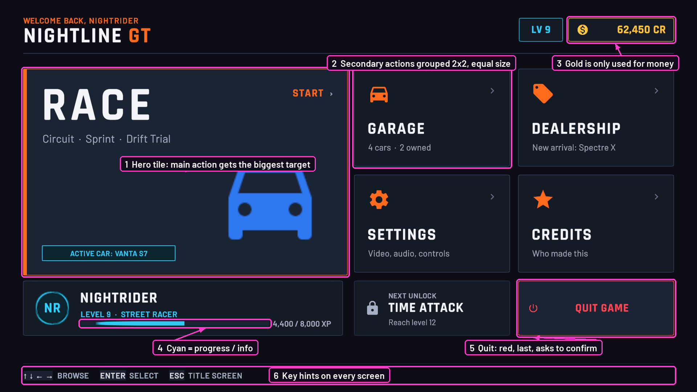

**Greyscale check:** the "ACTIVE CAR" tag text blended into its background, so I gave all tags a dark background with coloured text and border.

---

## 03 - Mode Select

**Purpose:** Pick Circuit, Sprint, Drift Trial or Time Attack (locked). Step 1 of 3.

**Design principles used**
* Four cards with the same layout so they're easy to compare.
* "STEP 1 OF 3" shows how long setup takes.
* The locked card is darker, has a lock icon and says "LV 12". Clicking it shakes and shows a message.

**Tweens and ease curves**
* Hover: orange border and grow (OutQuad).
* Locked click: short shake (0.4s).

**Greyscale check:** the locked card is clearly darker and keeps its lock icon. Tags fixed the same way as screen 02.

---

## 04 - Track Select

**Purpose:** Choose a track. Step 2 of 3. List on the left, details on the right.

**Design principles used**
* Selecting a row shows its details; clicking it or CHOOSE CAR moves on.
* The selected row has a cyan bar on its left, so it shows without colour too.
* Difficulty is shown as filled boxes.
* The locked track has a lock icon, and the button changes to a disabled "LOCKED".
* The step text shows the mode you picked.

**Tweens and ease curves**
* Changing track: the map icon shrinks out (InQuad, 0.1s) and pops back in (OutBack, 0.35s). Quick, so scrolling the list doesn't feel slow.
* The cyan bar fades between rows (0.15s).

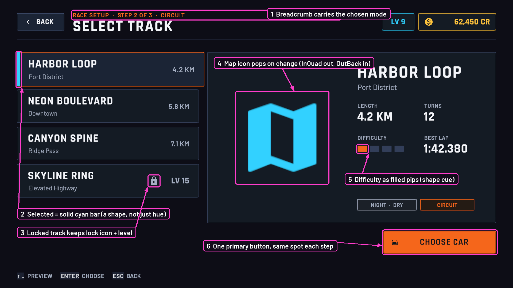
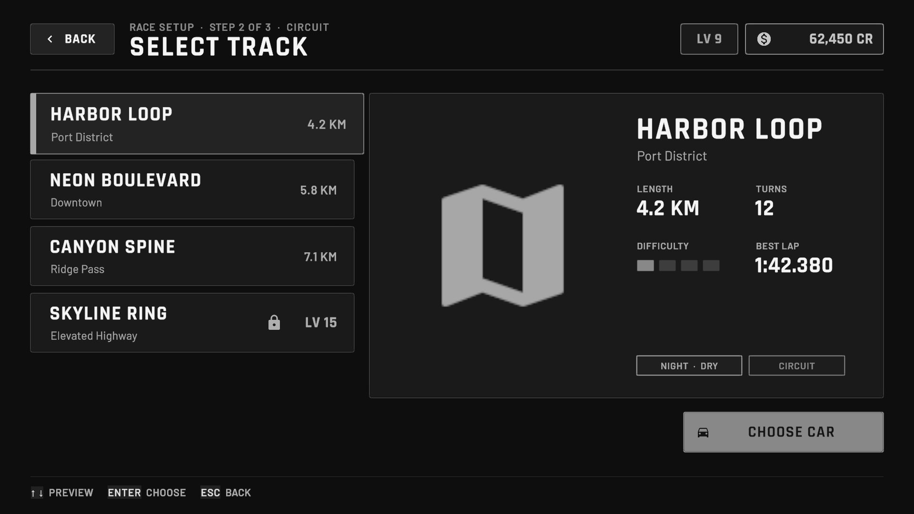

**Greyscale check:** the empty difficulty boxes almost disappeared, so I made them lighter.

---

## 05 - Garage

**Purpose:** Look at your cars and pick one. From the main menu you can set your active car; during race setup (step 3 of 3) you start the race. Cars you don't own link to the Dealership.

**Design principles used**
* The car name is the biggest text, and a big car icon in the car's colour is in the middle.
* The four stat bars are in the same place for every car so you can compare.
* Status is written as a word (ACTIVE / OWNED / NOT OWNED), not just a colour.
* The main button changes: START RACE, BUY IN DEALERSHIP, SET AS ACTIVE, or a disabled "ACTIVE CAR".

**Tweens and ease curves**
* Switching car: the icon slides out in the direction you pressed (InCubic) and the next one slides in (OutCubic).
* Stat bars fill to the new values (OutCubic, 0.5s) so you see what went up or down.

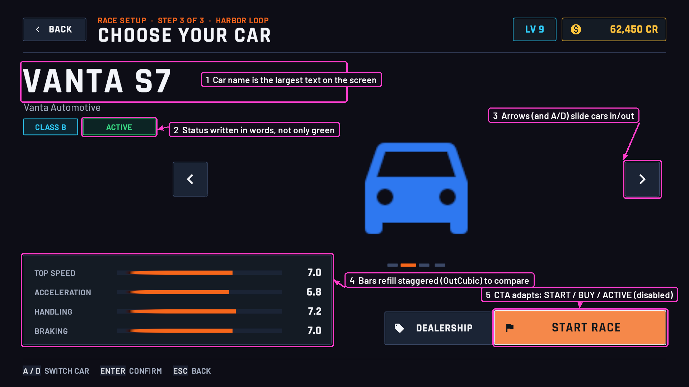
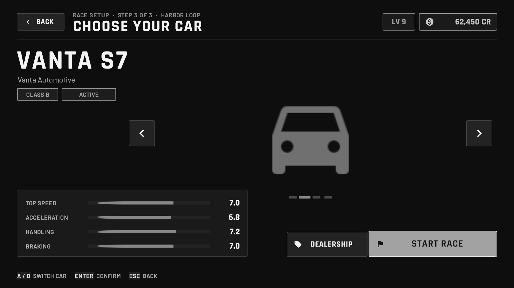

**Greyscale check:** bars and buttons were fine. Tags fixed the same way as screen 02.

---

## 06 - Dealership

**Purpose:** Buy cars and upgrades. Opened from the main menu or the garage.

**Design principles used**
* Six cards with the same layout so prices are always in the same spot.
* If you can't afford something, the price turns red, it says "NEED X MORE" and BUY is disabled.
* Owned items get an OWNED stamp and a disabled button.
* Buying asks for confirmation first, then shows a message.

**Tweens and ease curves**
* Your credits count down after buying (OutCubic, 0.8s).
* The OWNED stamp drops in from bigger (OutBack, 0.45s), like a rubber stamp.
* The confirm popup bounces in (OutBack).

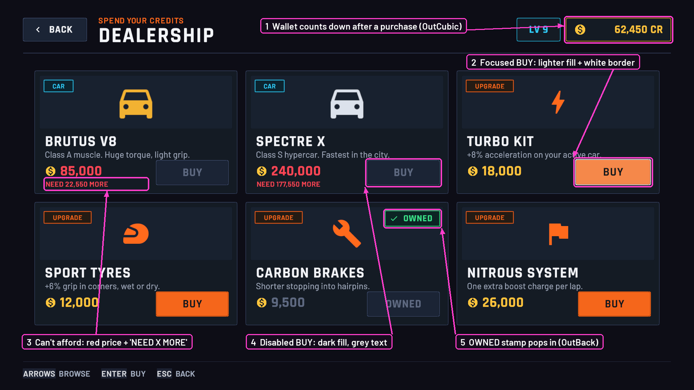
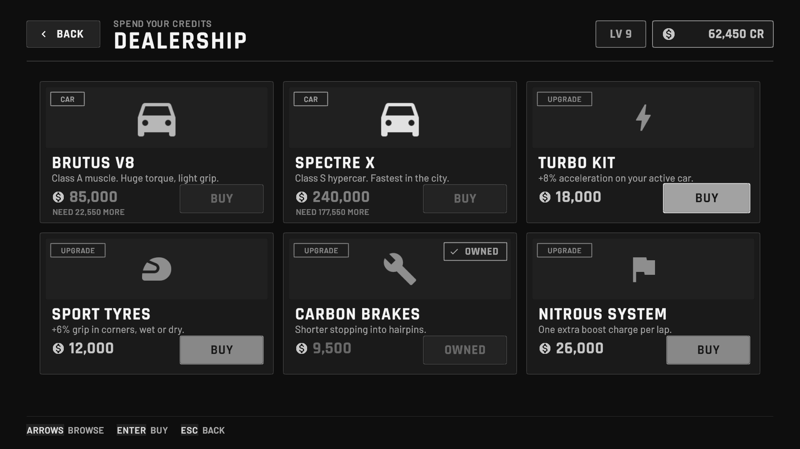

**Greyscale check:** enabled and disabled BUY buttons look clearly different. Tags fixed the same way as screen 02.

---

## 07 - Settings

**Purpose:** Video, audio and control options. Opened from the main menu or the pause menu.

**Design principles used**
* Three tabs keep each list short.
* Arrows for choices, switches with ON/OFF written next to them, and sliders with the number shown.
* A help panel explains the selected setting.
* "UNSAVED CHANGES" shows up if you change something, and leaving asks if you want to discard.

**Tweens and ease curves**
* The tab underline slides to the new tab (OutCubic) and the list slides up slightly.
* The switch knob slides (InOutQuad, 0.22s) like a real switch.
* Changed values do a small pop (OutBack).

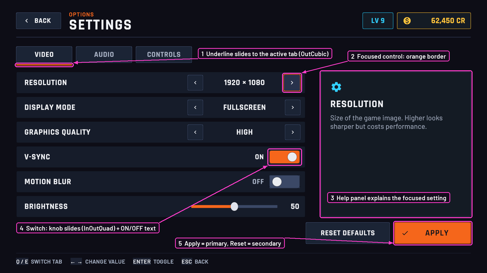

**Greyscale check:** ON and OFF switches are clearly different and have text. No change needed.

---

## 08 - Pause

**Purpose:** Pause the race: Resume, Restart, Settings or Quit to menu. Esc or the pause button opens it.

**Design principles used**
* The race stays visible behind a dark overlay so you know where you are.
* Resume is first and selected by default. Quit is red, separated by a line, and asks first.
* The line under PAUSED shows the mode, track and lap.
* HUD info sits in the corners: position and lap top left, speed bottom right, nitro bottom left.

**Tweens and ease curves**
* The overlay fades in (OutQuad, 0.2s) and the panel drops into place (OutBack, 0.4s). Resume closes it faster (InQuad, 0.15s).
* The game is paused with timeScale = 0, but the menu still animates because the tweens use unscaled time.

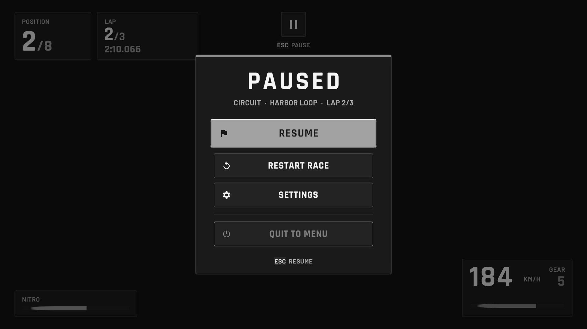

**Greyscale check:** the panel stands out from the background and Resume is the lightest button. No change needed.

---

## 09 - Results

**Purpose:** Show your result and rewards, then Continue, Race Again or Change Car.

**Design principles used**
* Reads left to right: your place, the leaderboard, your rewards, then the buttons.
* "2ND" is the biggest thing on screen.
* Your row has a cyan outline and a "YOU" tag.
* No Back button, because back would mean going into the finished race. Esc does the same as Continue.

**Tweens and ease curves**
* The place number pops in (OutBack, 0.6s).
* Credits count up (OutQuart, 1.2s) and the XP bar fills (OutCubic, 0.9s).

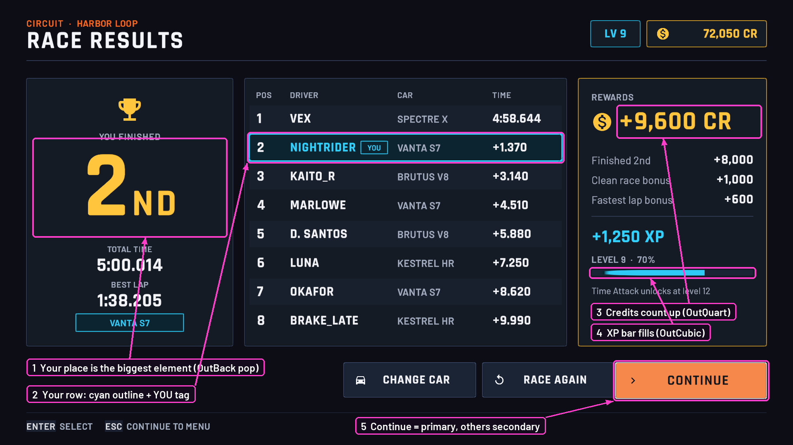

**Greyscale check:** your row stands out because of its outline and tag. No change needed apart from the tag fix.

---

## 10 - Credits

**Purpose:** Credits for the people, fonts and references.

**Design principles used**
* One centred column: small orange role, big white name.
* It scrolls by itself, and you can use the mouse wheel too.
* Back button, BACK TO MENU button and Esc all go back.

**Tweens and ease curves**
* Scrolls at a constant speed (Linear) because that's easiest to read.

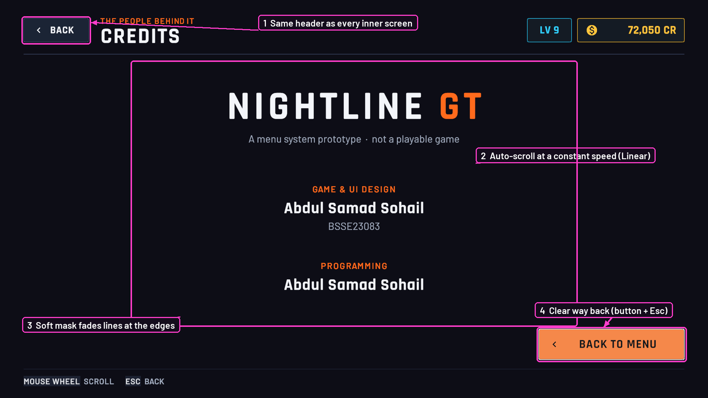
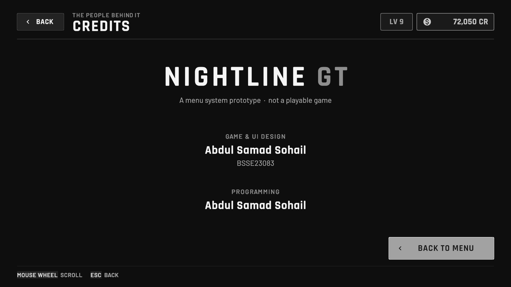

**Greyscale check:** orange role names turn grey but are still smaller than the names. No change needed.

---

## Credits and references

- Rajdhani font - Indian Type Foundry, SIL Open Font License (`Assets/Fonts/OFL-Rajdhani.txt`)
- Barlow font - Jeremy Tribby, SIL Open Font License (`Assets/Fonts/OFL-Barlow.txt`)
- Icons - Google Material Icons, Apache 2.0 (`Assets/Art/LICENSE-MaterialIcons.txt`)
- Rounded boxes and circles - Unity's built-in UI sprites
- Unity 6000.3.24f1, TextMesh Pro, Input System
- Inspiration only: Forza Horizon (Playground Games) and Need for Speed Underground / Heat (EA)

All car, track and driver names are made up.
