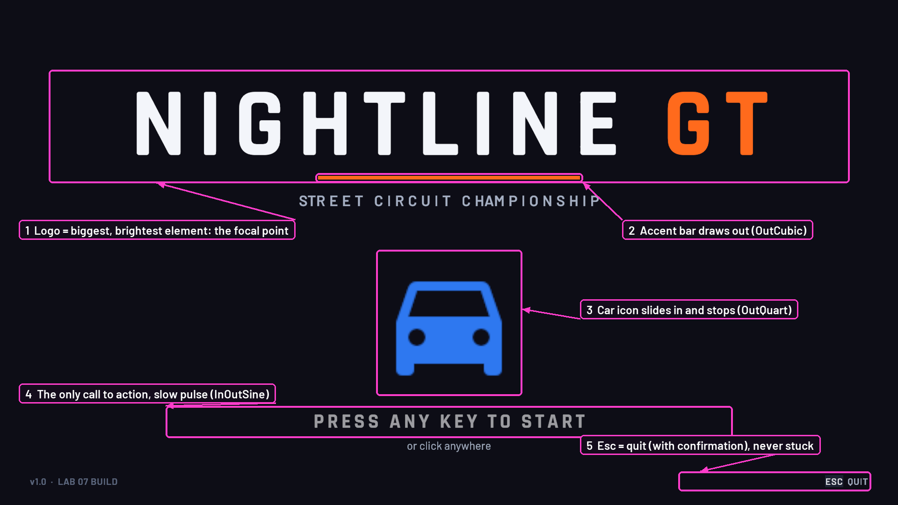
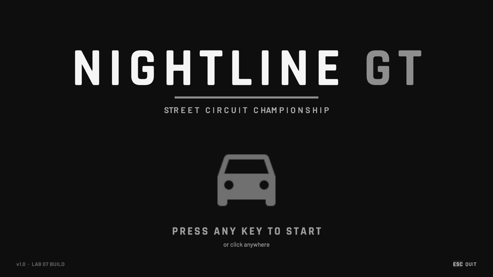
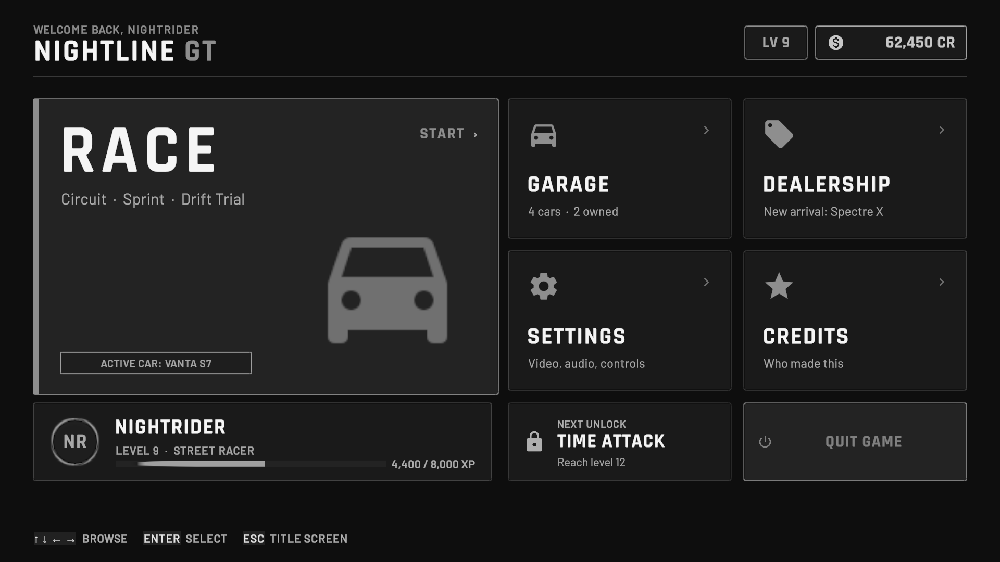
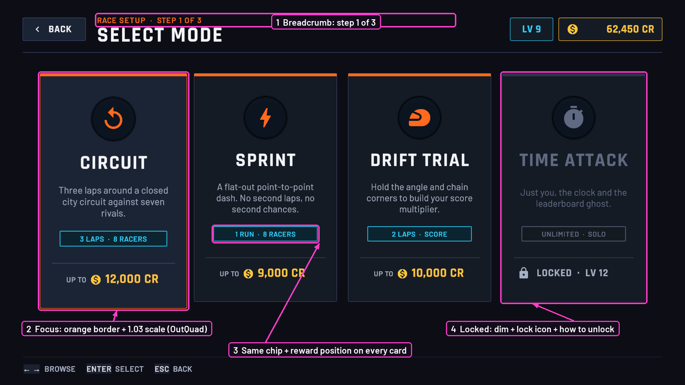
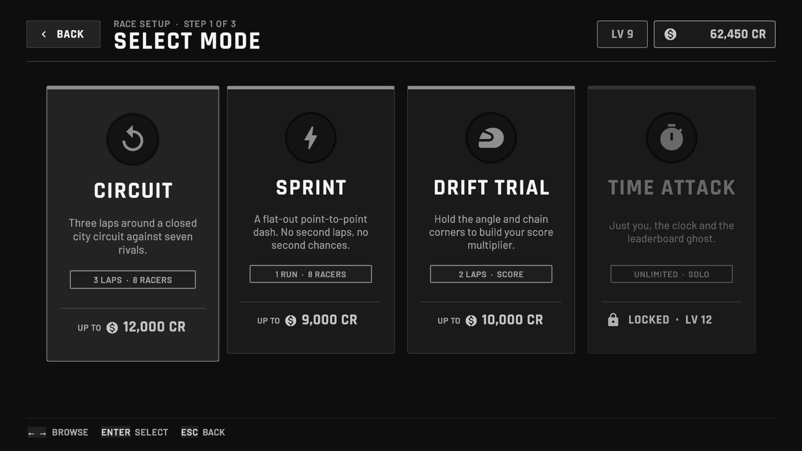
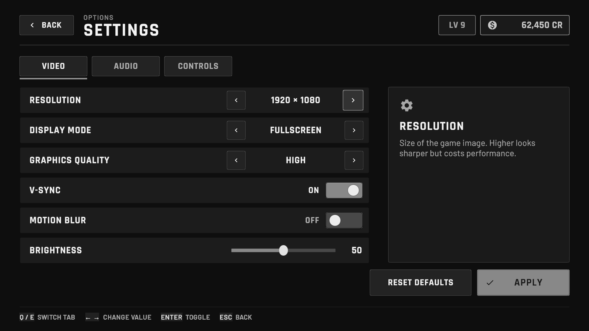
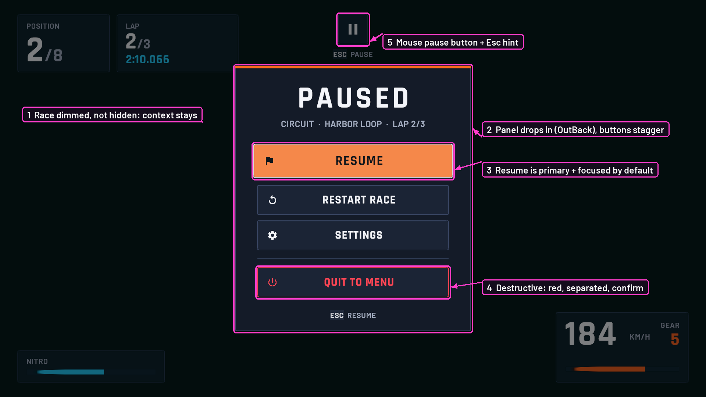
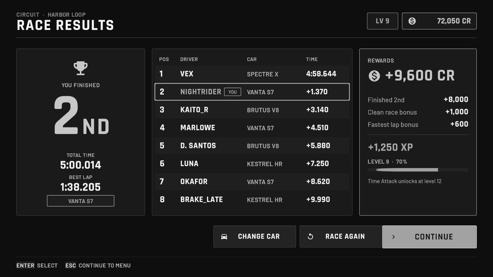

# Nightline GT - Menu System (CS-464 Lab 07)

Abdul Samad Sohail - BSSE23083

Unity version: **6000.3.24f1** (Unity 6, URP project, uGUI + TextMesh Pro, new Input System)
Platform: Windows desktop, mouse and keyboard, made at 1920x1080 (16:9)

## About

Nightline GT is a night street racing game I made up for this lab. Only the menus are built, so you can't actually drive. There are 10 screens and they all link together: title, main menu, mode select, track select, garage, dealership (shop), settings, the pause menu during a race, results and credits.

To make the pause and results screens make sense, starting a race shows a simple HUD and a fake race that lasts about 15 seconds. The HUD is mostly static on purpose (only the lap timer moves) because the menus are the point of this lab, not the race. You can pause it any time with Esc. When it ends you go to the results screen.

For the look I used Forza Horizon (big tiles in the main menu, bold condensed fonts) and Need for Speed Underground/Heat (dark night colours with orange and blue) as references. I only took layout and colour ideas from them, no assets. The icons are Google's free Material Icons and the rounded boxes/circles are Unity's built-in UI sprites.

## How to run

1. Open Unity Hub, click Add > Add project from disk and select this folder.
2. Open it with Unity 6000.3.24f1 (other 6000.3 versions should work too).
3. Open `Assets/Scenes/MainMenu.unity`.
4. Set the Game view to 16:9 or 1920x1080 and press Play.

I also made a Windows build (`Builds/Windows/NightlineGT.exe`). The Builds folder is in the .gitignore so it isn't on GitHub, I'm submitting it separately as a zip.

Controls:

| Key | Action |
|---|---|
| Mouse | hover and click buttons |
| Arrow keys + Enter | move between buttons and select |
| Esc | go back (works on every screen), pause/resume in a race, close a popup |
| A / D | change car in the garage |
| Q / E | change tab in settings |
| Mouse wheel | scroll the credits |

The UI is created by an editor script (`Assets/Editor/MenuSceneBuilder.cs`). I did it this way so all the screens use exactly the same sizes, colours and margins. If you change something in a screen's `Build()` function, run Tools > Nightline > Build Menu Scene to rebuild the scene.

Folders:
- `Assets/Scripts/Core` - tween code, MenuManager (screen switching), MenuButton (hover/click effects), colours
- `Assets/Scripts/Screens` - one script for each screen
- `Assets/Editor` - the scene builder
- `Assets/Art/Icons` - Material icons
- `Assets/Fonts` - Rajdhani and Barlow fonts with their licences
- `Docs/screenshots` - colour, annotated and greyscale screenshot for each screen

## Screen flow

- Title -> Main Menu (any key or click). Esc on the title asks if you want to quit.
- Main Menu -> Race -> Mode Select -> Track Select -> Garage (choose car) -> Race
- Main Menu -> Garage, Dealership, Settings, Credits, or Quit (asks first)
- Garage -> Dealership (to buy cars you don't own)
- Race: Esc or the pause button opens the Pause menu -> Resume, Restart, Settings, or Quit to menu (asks first)
- Race ends -> Results -> Continue (main menu), Race Again, or Change Car

I used a stack for navigation, so Back always takes you to the screen you came from. For example, Settings opened from the pause menu goes back to the pause menu, and the Dealership opened from the garage goes back to the garage. After a race, the history is reset to Main Menu -> Results so pressing back can't send you into a race that already finished. I went through all of these paths in Play mode and there are no dead ends.

## Things that are the same on every screen

**Colours**

| Colour | Hex | Used for |
|---|---|---|
| Dark navy | #0B0F17 | background |
| Panel greys/blues | #131A28, #1E2739, #2B3650 | panels, buttons, hover |
| Border | #3E4C6A | edges of panels so they don't merge with the background |
| White / grey text | #F3F5FA, #A6B0C4, #5F6A82 | headings, normal text, disabled text |
| Orange | #FF6A1A | things you can press, and the hover/focus border |
| Cyan | #33D1FF | selected things and info (level, XP, info tags) |
| Gold | #FFC53D | money and rewards only |
| Green / Red | #3BE089, #FF4757 | owned/success, and quit/danger/can't afford |

Orange and cyan are opposite each other on the colour wheel, so they stand out from each other on the dark background. I tried to give each colour one job so the player learns it quickly: orange = press this, cyan = selected/info, gold = money. Colour is never the only clue though. Selected and locked things also get an icon, a bar, a thicker border or a text label, which is what the greyscale screenshots check.

**Fonts**
- Rajdhani Bold for titles, numbers and buttons. It's narrow and square, like a car dashboard.
- Barlow for descriptions and small labels because it's easy to read at small sizes.
- Nothing you need to read is smaller than 20px at 1080p.

**Layout**
- 64px margin around the screen, and everything lines up on the same left edge.
- Every screen after the main menu has the same header (Back button, small orange "step" text, title, level and credits) and the same footer with keyboard hints. The main button is always in the bottom right corner.
- The Canvas Scaler is set to Scale With Screen Size (1920x1080, Expand). Header and footer are anchored to the top and bottom, and panels are anchored to corners, so it still fits at other resolutions like 1280x720 or 2560x1440.
- Buttons are at least 64px tall (most are 80-90px), so they are easy to click and would also work on a touch screen.

**Button feedback** (`MenuButton.cs`)
- Hover or keyboard focus: lighter colour, orange border, grows slightly (OutQuad). Hovering with the mouse also moves keyboard focus, so only one button is highlighted at a time.
- Click: shrinks to 0.95 and springs back (OutBack).
- Disabled: darkest colour with grey text, and the text usually says why (LOCKED, OWNED, ACTIVE CAR).
- Clicking something locked shakes it and shows a small message at the bottom explaining how to unlock it.
- Buying something or quitting shows a confirm popup, and Cancel is selected by default.

**Animations**

I wrote a small tween script (`Tween.cs`) instead of using a plugin. It uses unscaled time so the menus still animate when the race is paused (timeScale = 0).

| Animation | Ease | Why |
|---|---|---|
| Going to a new screen: slides in from the right and fades in | OutCubic (in), InCubic (out) | right = going deeper, left = going back, so you can tell which way you moved |
| Popups and the pause panel | OutBack | the small bounce makes it feel like it's on top of the screen |
| Credits, rewards, XP and stat bars counting/filling | OutCubic / OutQuart | you can see the number change, not just the end result |
| "Press any key" text | InOutSine (loop) | slow pulse that shows the game is waiting |
| Credits scrolling | Linear | same speed the whole time is easiest to read |
| Locked/error | shake | means "no" without words |

---

## 01 - Title screen

**Purpose:** Set the mood and get the player into the game with one input. Any key or click opens the Main Menu, and Esc asks whether to quit.

**Design principles used**
* Visual hierarchy: the logo is by far the largest and highest-contrast element. The tagline is smaller and dimmer, and the car sits in the middle so the eye travels logo -> car -> prompt.
* Colour: white logo with only "GT" in the accent orange. A big car icon sits under the logo so you can tell straight away it's a racing game.
* Single call to action: "PRESS ANY KEY TO START" is the only instruction. The secondary line "or click anywhere" covers mouse players.
* No dead end: the bottom-right hint shows that Esc quits (with a confirmation).
* Alignment: everything is centred on one vertical axis; version info and the quit hint sit in the corners at the 64 px margin.

**Tweens and ease curves**
* Logo scales from 1.15 -> 1 (OutCubic, 0.7 s): settles into place, so it's the first thing to arrive.
* Orange underline draws from 0 -> 560 px wide (OutCubic, 0.55 s, after 0.3 s): reveals the brand accent after the logo.
* Prompt alpha breathes 35 % ↔ 100 % (InOutSine, 1.6 s loop): shows the game is waiting for you.

**Greyscale check:** the logo, tagline and prompt are clearly separate brightness levels. "GT" goes mid-grey but stays readable, and it's a separate word anyway. No change needed.

---

## 02 - Main Menu

**Purpose:** The hub. Start a race, open the Garage, Dealership, Settings or Credits, see your profile/level, or quit.

**Design principles used**
* Hierarchy by size: RACE is a hero tile (880x560) because it's what most players want. The four secondary destinations are equal 2x2 tiles, and account info and quit form the bottom row.
* Grouping / proximity: the actions are grouped on the right and the "about you" info (profile, next unlock) at the bottom. The next-unlock card has no border highlight or chevron because it is information, not a button.
* Affordances: the tiles have chevrons and icons and highlight with an orange border on hover/focus. The hero tile shows a "START ›" cue and your active car.
* Colour roles: cyan for level/XP and the active-car chip, gold for the wallet, red for Quit. Quit is last in the reading order and asks for confirmation.
* Consistency: the same wallet pills and footer key hints as every other screen.

**Tweens and ease curves**
* Nothing pops in when the menu opens, it just slides in like every other screen. I tried making the tiles appear one by one but it was too much for a screen you see all the time.
* Hover: border tint + scale 1.03 (OutQuad, 0.18 s). The hero tile only grows 1.5 % because a large tile scaled more would overlap its neighbours.
* Screen enters from the right (OutCubic), since it's one level deeper than the title.

**Greyscale check:** the focused RACE tile is clearly lighter with a bright border. In the first pass the "ACTIVE CAR" chip text blended into its cyan-tinted fill, so I changed all chips to a near-black fill with a coloured border and text. Quit is separated by position and its icon, not only by red.

---

## 03 - Mode Select

**Purpose:** Pick a race type: Circuit, Sprint, Drift Trial or Time Attack (locked until level 12). Step 1 of 3 in race setup.

**Design principles used**
* Equal choices look equal: four identical cards with the same internal layout (icon -> name -> description -> info chip -> reward), so they're easy to compare.
* Breadcrumb: "RACE SETUP · STEP 1 OF 3" shows how long setup takes.
* Locked state with more than colour: the card is dimmed, the icon is grey, there's a lock icon and the text says exactly what's needed ("LOCKED · LV 12"). Clicking it shakes the card and shows a toast.
* Colour roles: orange top strip/icon = selectable, cyan chip = format info, gold = reward.
* Spacing: 32 px gaps and the cards are centred as a group.

**Tweens and ease curves**
* No entry animation on the cards, the normal screen slide is enough.
* Focus: orange border + scale 1.03 (OutQuad).
* Locked click: damped horizontal shake (0.4 s), the universal "no".

**Greyscale check:** the locked card is clearly darker and keeps its lock icon and text. The focused card is brightest with the thickest border. The chips were fixed with the dark fill (see 02).

---

## 04 - Track Select

**Purpose:** Choose where to race. Step 2 of 3. The list on the left is for scanning; the detail panel on the right is for deciding.

**Design principles used**
* Master/detail layout: focusing a row previews it, and clicking it (or the big button) commits.
* Selected state is not colour-only: a solid cyan bar on the left edge of the row (a shape you can see even without colour).
* Data as shape: difficulty is shown as four pips (filled vs. empty), so it can be read at a glance without numbers.
* Locked track: lock icon + required level in the row. Selecting it changes the main button to a disabled "LOCKED".
* Breadcrumb carries context: the kicker repeats the mode you picked ("… · CIRCUIT"), and so does the orange chip in the panel.
* One primary action, same place: "CHOOSE CAR" bottom-right, where "START RACE" will be on the next step.

**Tweens and ease curves**
* Changing track: the map icon shrinks/fades (InQuad, 0.1 s) and pops back with the new track's details (OutBack, 0.35 s). Short and clear, so scrolling quickly through the list never feels slow.
* The selection outline cross-fades between rows (0.15 s).

**Greyscale check:** I made the empty difficulty pips lighter (border colour instead of the panel colour) because they disappeared against the panel. The selected row stays obvious through its bar. The chips got the dark-fill fix.

---

## 05 - Garage / Choose Your Car

**Purpose:** Browse your cars and pick one. Opened from the Main Menu it's a collection ("SET AS ACTIVE"). Opened from Track Select it's step 3 of 3 ("START RACE"). Cars you don't own link to the Dealership.

**Design principles used**
* Hierarchy: car name (100 px) -> maker -> chips. A big car icon, tinted in that car's colour, is the visual centre.
* Comparison: the same four stat bars in the same place for every car, with numbers next to them.
* Status in words: the chip says "ACTIVE", "OWNED" or "NOT OWNED", not only a colour.
* Adaptive primary button: START RACE / BUY IN DEALERSHIP / SET AS ACTIVE, or a *disabled* "ACTIVE CAR" when there's nothing to do.
* Pager dots: the wide orange dot shows your position in the list of four cars.
* Large round arrow buttons plus A/D keys for switching cars.

**Tweens and ease curves**
* Switching car: the car icon slides off in the direction you pressed (InCubic, 0.14 s) and the next one rolls in from the other side (OutCubic, 0.42 s). Direction matches the arrow you used.
* Stat bars refill from their old values to the new ones (OutCubic, 0.5 s, 50 ms stagger), so you see which stats went up or down.

**Greyscale check:** the bars, buttons and arrows all hold up. The "CLASS B"/"ACTIVE" chips were the problem here too (text close to the fill value) and were fixed with the dark chip fill.

---

## 06 - Dealership (shop)

**Purpose:** Spend credits on cars and upgrades. Reachable from the Main Menu and from the Garage.

**Design principles used**
* Consistency for comparison: six cards with the same layout (art -> type chip -> name -> one-line description -> price -> BUY), so price is always in the same spot.
* Affordability shown three ways: price turns red, a "NEED 22,550 MORE" line appears and the BUY button is disabled.
* Owned: green "✓ OWNED" stamp + a disabled button labelled "OWNED".
* Feedback: buying asks for confirmation and shows exactly how much will be taken. Afterwards the wallet counts down, the card gets stamped and a toast confirms the purchase.
* Type chips: CAR (cyan) vs UPGRADE (orange).

**Tweens and ease curves**
* After a purchase the wallet number counts down (OutCubic, 0.8 s), so the cost is "felt".
* The OWNED stamp slams in from 1.8x scale (OutBack, 0.45 s), like a rubber stamp.
* The confirm dialog scales up with an overshoot (OutBack) over a dimmed screen. The toast slides up (OutBack) and fades away after about 2 s.

**Greyscale check:** enabled BUY (light grey with dark text) and disabled BUY (dark with grey text) are clearly different. Red prices turn darker than gold ones and also carry the "NEED … MORE" text. The chips were fixed with the dark fill.

---

## 07 - Settings

**Purpose:** Video, audio and control options. Opened from the Main Menu *or* the pause menu, and Back returns to whichever one opened it.

**Design principles used**
* Tabs (Video / Audio / Controls) keep each list short (5-6 rows).
* Three control types, each with a clear affordance: `‹ value ›` selectors, ON/OFF switches (with the word "ON/OFF" next to them), and sliders with the number shown.
* Help panel on the right explains whatever setting has focus, which helps with jargon like V-Sync.
* Safe changes: "● UNSAVED CHANGES" appears when something changed. Leaving without applying asks "Discard changes?". Reset is secondary and Apply is primary.
* Alignment: labels left-aligned in one column, controls right-aligned in another.

**Tweens and ease curves**
* Tab underline slides to the new tab (OutCubic, 0.28 s) and the page content slides up 24 px + fades (OutCubic), so the tab and the content feel connected.
* Switch knob slides and the track recolours (InOutQuad, 0.22 s), easing both ways like a physical switch.
* Selector value "ticks" (scale 0.8 -> 1, OutBack) so the change is noticed.
* The unsaved-changes label pops in (OutBack).

**Greyscale check:** the ON switch is a much lighter track than OFF and has the ON/OFF text. The active tab has the underline and brighter text, and the focused arrow has a bright border. No change needed.

---

## 08 - Race HUD + Pause menu

**Purpose:** Pause the (simulated) race: Resume, Restart, Settings or Quit to menu. Esc or the on-screen pause button opens this menu, and Esc again resumes.

**Design principles used**
* Context stays visible: the race is dimmed behind a 78 % dark overlay rather than hidden, so you know where you are.
* Order by frequency and risk: RESUME (primary, focused by default) -> Restart -> Settings -> separator -> QUIT TO MENU in red, which also asks for confirmation.
* Info line under the title: mode · track · lap.
* HUD (behind): position, lap and time top-left, speed and gear bottom-right, nitro bottom-left, on a plain dark background. These are the usual corners for racing HUDs, so the centre of the screen stays free for the road.
* Mouse support: a round pause button with an "ESC PAUSE" hint under it.

**Tweens and ease curves**
* Pause: overlay fades in (OutQuad, 0.2 s), the panel drops 60 px into place (OutBack, 0.4 s). Resume reverses this quickly (InQuad, 0.15 s) so the player gets back to racing fast.
* `Time.timeScale` is set to 0, and because all UI tweens use unscaled time the menu stays smooth while the race is frozen.
* The race HUD itself is kept static (no countdown, fixed speed and position). Only the lap timer moves so you can see the race is running and it ends on its own.

**Greyscale check:** the panel separates from the dimmed background, and Resume is clearly the lightest button. Quit is darker and set apart by the separator line and position as well as the colour. No change needed.

---

## 09 - Race Results

**Purpose:** Show how the race went and what you earned, then offer the next step: Continue (to Main Menu), Race Again, or Change Car.

**Design principles used**
* Left-to-right story: where you finished -> how it compares -> what you earned -> what's next (buttons bottom-right).
* Hierarchy: the place ("2ND") is the largest element on the screen, in gold with a trophy.
* Finding yourself: your leaderboard row has a cyan outline, cyan name *and* a "YOU" tag. Alternate rows have a faint stripe to help the eye follow across the columns.
* Reward breakdown so the total makes sense, plus XP progress towards the next unlock (a goal for the next race).
* No Back button here on purpose: going "back" would mean returning into the race. Esc does the same as Continue.

**Tweens and ease curves**
* The place number pops from 0.4x (OutBack, 0.6 s): it's the headline.
* The reward total and the header wallet count up together (OutQuart, 1.2 s), so you see the money arrive.
* The XP bar fills from the old to the new value (OutCubic, 0.9 s).

**Greyscale check:** the gold place number is still the brightest thing on screen, and your row is clear because of its outline and the YOU tag. The chip under the time got the dark-fill fix.

---

## 10 - Credits

**Purpose:** Credit the people, fonts, tools and references. Reached from the Main Menu.

**Design principles used**
* Simple centred column: small orange role labels above large white names, with generous spacing between sections.
* Two ways to read: it scrolls itself, and the mouse wheel takes over at any time (auto-scroll resumes 3 s later).
* Clear exit: the header Back button, a primary "BACK TO MENU" button and Esc.
* Soft edge mask so lines fade in and out instead of being cut off.

**Tweens and ease curves**
* Auto-scroll at a constant 60 px/s (Linear): steady speed is easiest to read, and an ease would make the text speed up and slow down.
* The screen enters from the right like every other forward step (OutCubic).

**Greyscale check:** role labels (orange) become mid-grey and stay clearly below the white names in the hierarchy. No change needed.

---

## About the screenshots

Every screen has three images in `Docs/screenshots/`:

* `NN-name-colour.png`: the original colour capture at 1920x1080, taken in Play mode from the game camera, so there are no gizmos or editor UI.
* `NN-name-annotated.png`: the colour capture with magenta boxes, arrows and numbered callouts. I used magenta because it doesn't appear anywhere in the game UI, so the notes never blend in.
* `NN-name-greyscale.png`: a duplicate converted to greyscale (saturation 0, luminance-based). The colour original was kept.

Changes I made after checking greyscale: darker fills on all chips (02-06, 09), visible empty difficulty pips (04). After these fixes I captured the screens again.

---

## Credits and references

| What | Source / licence |
|---|---|
| Design, programming, UI | Abdul Samad Sohail (BSSE23083) |
| Rajdhani typeface | Indian Type Foundry, via Google Fonts, SIL Open Font License 1.1 (`Assets/Fonts/OFL-Rajdhani.txt`) |
| Barlow typeface | Jeremy Tribby, via Google Fonts, SIL Open Font License 1.1 (`Assets/Fonts/OFL-Barlow.txt`) |
| Icons | Material Icons by Google, Apache License 2.0 (`Assets/Art/LICENSE-MaterialIcons.txt`). No AI-generated images are used |
| Rounded boxes, circles | Unity's built-in UI sprites (UISprite, Knob) |
| Engine and packages | Unity 6000.3.24f1, uGUI, TextMesh Pro (and its essential resources), Input System |
| Visual references (inspiration only) | *Forza Horizon* series (Playground Games / Xbox Game Studios): tile-based hub and bold condensed type. *Need for Speed* series, especially *Underground* and *Heat* (EA / Criterion / Ghost Games): night-city mood and orange-blue palette |
| Course | CS-464 Game Development, Information Technology University (ITU), Lahore |

All car, track and driver names (Kestrel HR, Vanta S7, Brutus V8, Spectre X, Harbor Loop, etc.) are made up for this project.
